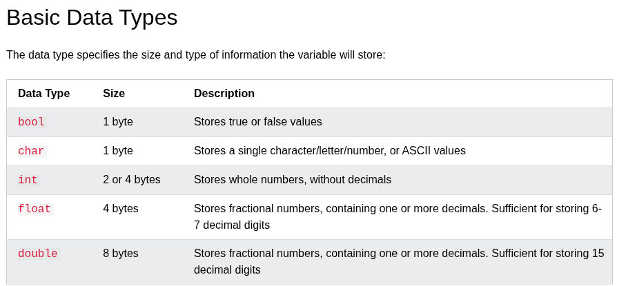
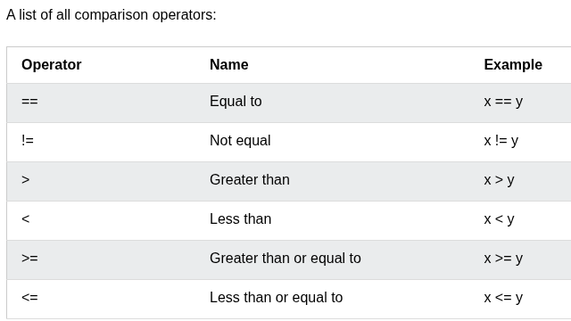

1. any type of argument. what are all  the types there?

2. must support all the comparison operators. what comparison operators are there ?

1. `::swap( a, b );` , why there is no class name before the :: scope resolution ?
2. template 
3. 